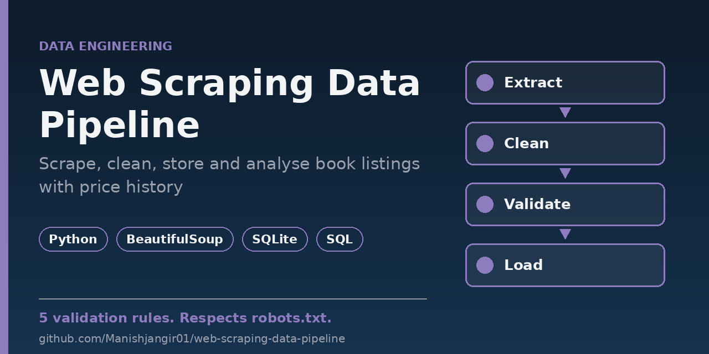
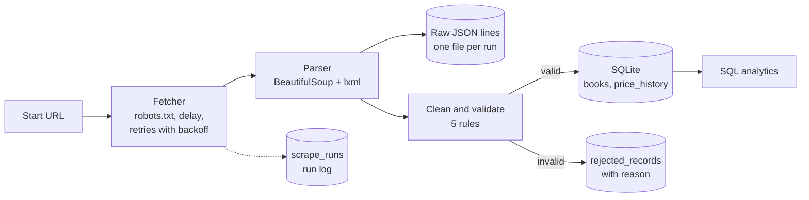

# Web Scraping Data Pipeline

[](https://github.com/Manishjangir01/web-scraping-data-pipeline/actions/workflows/tests.yml)




An automated **scrape -> clean -> store -> analyse** pipeline in Python. It collects book listings from [books.toscrape.com](https://books.toscrape.com/) (a practice site that exists to be scraped), keeps the raw data, validates every record, loads the good ones into **SQLite** without creating duplicates, tracks **price changes over time**, and answers questions with **SQL**.

> **Note on testing:** the tests and the example output below use a small local web server that copies the markup of books.toscrape.com. The live site was not scraped while building this project (the build environment had no access to it). A GitHub Actions workflow (`scrape`) runs the real scraper on a schedule, and the first run of that workflow is the first live check. If the site changes its HTML, the run is marked `empty` instead of silently storing nothing.

## Pipeline



| Stage | What it does |
|-------|--------------|
| Fetch | Downloads one page at a time with a descriptive User-Agent. Checks `robots.txt`, waits between requests, retries timeouts and 429/5xx errors with exponential backoff |
| Parse | Reads title, link, price text, star rating, availability and the "next" link from every listing page |
| Raw layer | Saves exactly what was scraped as JSON lines (`data/raw/books_runNNNN.jsonl`), before any cleaning |
| Clean and validate | Converts price and rating to numbers, drops bad rows into an audit table with a reason |
| Load | Upserts into SQLite by URL. Running it twice creates no duplicates, and a `price_history` row is added only when the price changed |
| Analytics | Six SQL queries in [`sql/analytics.sql`](sql/analytics.sql) |
| Run log | Every run is recorded in `scrape_runs` with its status and counts |

## Data quality rules

| Reason | Rule |
|--------|------|
| `missing_title` | the title is empty |
| `missing_url` | the link is empty or not an http(s) URL |
| `invalid_price` | no price, or not between 0 and 10,000 |
| `invalid_rating` | the star rating is missing or not One to Five |
| `duplicate_url` | the same book appeared earlier in this run (the first copy is kept) |

A record is rejected for the first rule it breaks. The rejected row keeps its raw values, so nothing is lost.

## Reliability and good manners

- **robots.txt** is read once per site. If it cannot be read, nothing is fetched.
- **Polite delay** of 1 second between requests (`--delay`).
- **Retries** with exponential backoff for timeouts, connection errors and 429/5xx answers. A 404 is not retried.
- **Honest status** for every run: `ok`, `partial` (a later page failed, earlier pages were still saved), `failed`, or `empty` (pages loaded but held no books, usually a markup change). The command exits with a non-zero code unless the status is `ok`.
- **Encoding fix:** some servers send HTML without a charset, which turns `£` into `£`. The fetcher forces UTF-8, and the price parser also copes with the broken form.

## Example run

Two runs against the local test server (3 listing pages, 14 books, 3 of them deliberately bad):

| | Run 1 | Run 2 (same data) |
|---|------:|------:|
| Pages fetched | 3 | 3 |
| Raw records | 14 | 14 |
| Clean records | 11 | 11 |
| Rejected | 3 (`duplicate_url`, `invalid_price`, `invalid_rating`) | 3 |
| New books added | 11 | **0** |

Output of `python -m scrapepipe report` after those runs:

```
== price_by_rating ==
rating  books  avg_price  min_price  max_price
------  -----  ---------  ---------  ---------
5       2      53.26      52.29      54.23
4       2      40.58      33.34      47.82
3       2      34.85      17.93      51.77
2       1      13.99      13.99      13.99
1       4      37.59      22.65      53.74

== stock_summary ==
availability  books  share_pct
------------  -----  ---------
in stock      10     90.9
out of stock  1      9.1
```

## Run it

```bash
pip install -e ".[dev]"

python -m scrapepipe run --max-pages 3       # scrape, clean and store in data/books.db
python -m scrapepipe report                  # print the SQL analytics
pytest -v
```

Useful options for `run`: `--start-url`, `--db`, `--raw-dir`, `--max-pages`, `--delay`, `--retries`, `--backoff`.

Run it again later against the same `--db` file to see new books and price changes (`price_changes` query).

## Automation

- **`tests`** workflow: runs the test suite on every push and pull request.
- **`scrape`** workflow: runs the real scraper every Monday at 06:00 UTC (and on demand), prints the report and uploads the database as a downloadable artifact. Each scheduled run starts with an empty database, so price history builds up only when you keep running locally against one database file.

## Tests

44 tests, all using a local web server instead of the real site:

- **Parser:** fields, relative links, the last page, a missing price
- **Cleaning:** every rejection reason, price formats, duplicates
- **Fetcher:** retries after 503, giving up, no retry on 404, robots.txt allow, block and unreachable cases, polite delay
- **Storage:** no duplicates on a second run, price history, database constraints
- **Pipeline and CLI:** full run over three pages, partial and failed runs, exit codes, analytics numbers

## Project structure

```
src/scrapepipe/
    fetcher.py    # requests session, retries, robots.txt, polite delay
    parser.py     # BeautifulSoup parsing of listing pages
    clean.py      # validation rules and price/rating conversion
    store.py      # SQLite schema and idempotent upserts
    pipeline.py   # scrape -> raw file -> clean -> store, run status
    report.py     # runs sql/analytics.sql
    cli.py        # python -m scrapepipe run | report
sql/analytics.sql
tests/            # includes helpers.py, a local copy of the site's markup
.github/workflows/
```

## Limitations

- Only the listing pages are scraped, not the individual book pages.
- SQLite and a single process. There is no scheduler other than GitHub Actions.
- The live site has not been scraped from the build environment (see the note at the top).

## Ideas for next steps

- Scrape the book detail pages (category, description, stock count)
- Load into PostgreSQL and schedule with Apache Airflow
- Alert when a run ends as `empty` or `failed`

## License

MIT, see [LICENSE](LICENSE).
